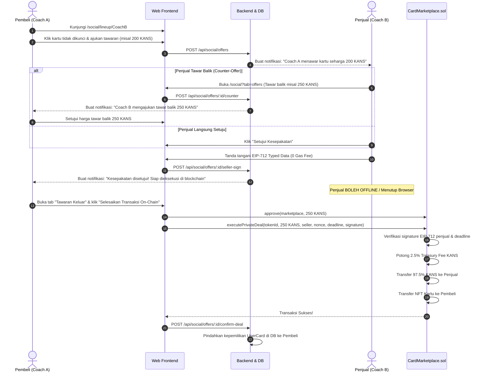

# 08 — Fitur Sosial, Komunitas, dan Negosiasi Kartu P2P (Dual-Agreement Offline-Tolerant)

Dokumen ini menjelaskan arsitektur, mekanisme teknis, dan alur kerja fitur sosial, penguncian kartu (*card lock*), serta sistem negosiasi transfer kartu antar pemain (*P2P Negotiation*) di ekosistem **W3 Football KANS Manager**.

---

## 1. Latar Belakang & Dua Model Transaksi Kartu

Untuk memberikan fleksibilitas penuh kepada para manajer, sistem pasar kartu dibagi menjadi **dua model utama**:

1. **Model A: Pasar Terbuka (Public Marketplace / Fixed Price - Pajang Dulu)**
   - Penjual memajang kartu di bursa publik (`/market`) dengan harga pasti (*instant buy*).
   - Kartu **tidak ditahan (*escrow lock*)**, sehingga penjual tetap bisa memainkan kartu tersebut di Skuad 4-3-3 dan Arena Pertandingan hingga ada manajer lain yang membelinya.
   - Pembeli yang bersedia membayar harga pasti dapat langsung membeli secara on-chain dalam 1 kali transaksi.

2. **Model B: Negosiasi Sosial & P2P (Bargaining / Offer & Counter-Offer)**
   - Manajer dapat menjelajahi daftar teman atau manajer lain di menu Komunitas (`/social`).
   - Manajer dapat mengunjungi dan melakukan *scouting* terhadap susunan taktik Lineup 4-3-3 manajer lawan (`/social/lineup/[username]`).
   - Apabila tertarik pada salah satu kartu yang **tidak dikunci**, manajer dapat mengajukan tawaran harga KANS.
   - Pemilik kartu dapat menerima, menolak, atau melakukan tawar-menawar balik (*counter-offer*) secara fleksibel hingga kedua belah pihak mencapai kesepakatan harga (*deal*).
   - Transaksi on-chain dieksekusi menggunakan **EIP-712 Typed Signature**, sehingga **penjual bisa langsung offline** setelah menyetujui, dan pembeli mengeksekusi transfer on-chain kapan saja secara atomik.

---

## 2. Fitur Penguncian Kartu (Card Lock / Untouchable)

### 2.1. Tujuan
Setiap manajer memiliki kartu-kartu andalan yang tidak ingin dilepas atau diganggu oleh tawaran transfer manajer lain. Fitur **Kunci Kartu** memungkinkan manajer menandai kartu sebagai *Untouchable* / *Not For Sale*.

### 2.2. Cara Kerja
1. **Toggle di Halaman Squad (`/squad`):**
   - Di panel pengaturan skuad, setiap kartu memiliki tombol toggle kunci:
     - 🔓 **Buka Kunci (Open for Offers):** Kartu dapat ditawar oleh teman/manajer lain saat mereka menginspeksi lineup Anda.
     - 🔒 **Kunci Kartu (Not For Sale):** Menolak semua tawaran transfer masuk secara otomatis.
2. **Proteksi Backend & Database:**
   - Field `isLocked Boolean @default(false)` pada tabel `UserCard`.
   - Endpoint `POST /api/social/cards/:cardId/lock` memvalidasi kepemilikan kartu dan mengubah status kunci.
   - Endpoint pengajuan tawaran (`POST /api/social/offers`) secara ketat memverifikasi status kunci: jika `card.isLocked === true`, request langsung ditolak dengan pesan:
     > *"🔒 Kartu ini telah DIKUNCI oleh pemiliknya dan tidak menerima tawaran transfer."*
3. **Indikator Visual di UI:**
   - Komponen `PlayerCard` menampilkan badge gembok 🔒 di mode ringkas (*compact pitch*) dan label `🔒 Dikunci (Not For Sale)` di tampilan kartu penuh.
   - Pada halaman scouting lawan (`/social/lineup/[username]`), kartu yang dikunci menampilkan banner peringatan khusus dan tombol tawar dinonaktifkan (*disabled*).

---

## 3. Komunitas, Daftar Manajer & Scouting Lineup 4-3-3

### 3.1. Daftar Manajer & Sistem Pertemanan
Halaman `/social` menyediakan hub interaksi antar manajer:
- **Pencarian Manajer:** Mencari manajer lain berdasarkan *username*.
- **Profil Singkat:** Menampilkan jumlah kartu koleksi, total kemenangan di Free Match Arena, serta akumulasi poin manajer.
- **Permintaan Pertemanan:**
  - Manajer dapat mengirim permintaan berteman (*Add Friend*).
  - Target manajer menerima notifikasi langsung di bilah navigasi (`Navbar`).
  - Permintaan dapat diterima (*Accept*) atau ditolak (*Reject*).

### 3.2. Mode Scouting Lineup Lawan (`/social/lineup/[username]`)
- Menampilkan visual lapangan hijau 4-3-3 interaktif dari Starting XI manajer yang dikunjungi.
- Menghitung rata-rata peringkat tim (*Team OVR*) lawan secara akurat.
- Memberikan pengalaman *scouting* mendalam: manajer dapat mengklik setiap pemain untuk menganalisis statistik 6 atribut (Pace, Shooting, Passing, Dribbling, Defending, Physical), posisi detail, kartu edisi, dan level kartu.

---

## 4. Siklus Negosiasi P2P (Offer & Counter-Offer)

Alur tawar-menawar dirancang fleksibel melalui kotak masuk negosiasi (`/social?tab=offers`):



---

## 5. Eksekusi On-Chain Toleran Kondisi Offline (EIP-712 Private Deal)

### 5.1. Struktur Typed Data EIP-712
Untuk menjamin keamanan tanpa memerlukan penjual standby online pada waktu yang sama dengan pembeli:
```solidity
struct PrivateDeal {
    address seller;
    address buyer;
    uint256 tokenId;
    uint256 price;
    uint256 nonce;
    uint256 deadline;
}
```

### 5.2. Keamanan Smart Contract (`CardMarketplace.sol`)
Fungsi `executePrivateDeal`:
1. **Verifikasi Tanda Tangan:** Menggunakan standar `ECDSA.recover` pada EIP-712 domain separator `W3CardMarketplace` versi `1`.
2. **Verifikasi Peserta:** `msg.sender` **wajib** sama dengan `deal.buyer`.
3. **Cek Deadline & Nonce:** Menghindari serangan *replay attack* dengan pencatatan nonce unik per transaksi.
4. **Pemberian Hak:** Penjual hanya perlu memastikan telah mengaktifkan `setApprovalForAll` sekali untuk kontrak marketplace.
5. **Pembagian Pembayaran & Fee:**
   - 2.5% fee dipotong dan dikirim ke *Treasury Game*.
   - 97.5% pembayaran KANS langsung ditransfer ke dompet penjual (meskipun penjual sedang offline).
6. **Deaktivasi Listing Terbuka Otomatis:** Jika kartu tersebut kebetulan sedang dipajang di public marketplace, listing publiknya langsung dinonaktifkan otomatis.

---

## 6. Struktur Basis Data (Prisma Schema)

```prisma
model UserCard {
  id          String        @id @default(cuid())
  userId      String
  playerId    Int
  position    String
  baseOverall Int
  level       Int           @default(1)
  rarity      String
  edition     String
  season      Int           @default(2025)
  isOnChain   Boolean       @default(false)
  tokenId     Int?
  isListed    Boolean       @default(false)
  isLocked    Boolean       @default(false) // Fitur Kunci Kartu (Not For Sale)

  user        User          @relation(fields: [userId], references: [id], onDelete: Cascade)
  player      Player        @relation(fields: [playerId], references: [id])
  offers      CardOffer[]
}

model Friendship {
  id         String   @id @default(cuid())
  senderId   String
  receiverId String
  status     String   @default("PENDING") // PENDING | ACCEPTED | REJECTED
  createdAt  DateTime @default(now())

  sender     User     @relation("FriendSent", fields: [senderId], references: [id], onDelete: Cascade)
  receiver   User     @relation("FriendReceived", fields: [receiverId], references: [id], onDelete: Cascade)

  @@unique([senderId, receiverId])
}

model CardOffer {
  id              String   @id @default(cuid())
  cardId          String
  buyerId         String
  sellerId        String
  priceKans       String
  status          String   @default("PENDING") // PENDING | COUNTERED | ACCEPTED | REJECTED | EXECUTED | EXPIRED
  lastActionBy    String
  sellerSignature String?
  nonce           String?
  deadline        String?
  history         String   @default("[]") // JSON string histori negosiasi
  createdAt       DateTime @default(now())
  updatedAt       DateTime @updatedAt

  card            UserCard @relation(fields: [cardId], references: [id], onDelete: Cascade)
  buyer           User     @relation("BuyerOffers", fields: [buyerId], references: [id], onDelete: Cascade)
  seller          User     @relation("SellerOffers", fields: [sellerId], references: [id], onDelete: Cascade)
}

model Notification {
  id        String   @id @default(cuid())
  userId    String
  title     String
  message   String
  type      String   // FRIEND_REQUEST | FRIEND_ACCEPTED | OFFER_RECEIVED | OFFER_COUNTERED | OFFER_ACCEPTED | DEAL_COMPLETED
  link      String?
  isRead    Boolean  @default(false)
  createdAt DateTime @default(now())

  user      User     @relation(fields: [userId], references: [id], onDelete: Cascade)
}
```

---

## 7. Rangkuman Manfaat bagi Pengguna

- **Kenyamanan Pemain:** Pemain tidak dipaksa standby pada jam yang sama untuk melakukan tukar-menawar atau transaksi kartu.
- **Keamanan Total:** Tidak ada kartu yang bisa berpindah tanpa tanda tangan kriptografi dari kedua belah pihak dan verifikasi on-chain.
- **Kedaulatan Skuad:** Manajer memiliki kendali mutlak untuk mengunci pemain bintang mereka agar tidak ditawar orang lain.
- **Interaksi Sosial yang Hidup:** Menghadirkan dinamika bursa transfer sepak bola dunia nyata ke dalam game Web3 dengan notifikasi interaktif dan *scouting* lineup 4-3-3.
